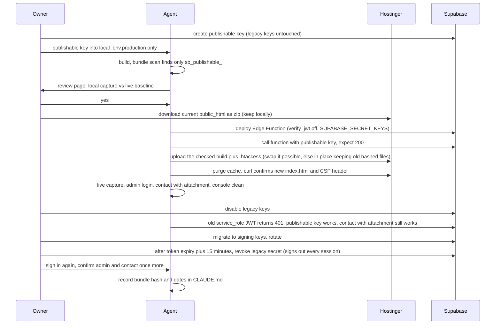

# feat: Stabilize and secure the live portfolio (Phases 0 to 6)

## Overview

> **Phase renumbering (owner, 2026-11-09).** A content refresh phase was added after Phase 4. Final order: Phase 4 Admin, **Phase 5 Content refresh (new)**, Phase 6 Responsive (written below as Phase 5), Phase 7 Banner (written below as Phase 6), then the single final deploy (owner decision 2026-11-03: the separate security deploy was deferred into it), then Phase 8 the new portfolio (formerly Phase 7). Unit numbers below keep their original labels.

Replace the 2025 build that is live on Hostinger with the hardened 2026 build without changing what visitors see, kill the leaked Supabase service-role key with zero visitor downtime, bring the project data up to date from the audited catalogue, make every admin manager work behind an email link plus an authenticator-app second factor enforced in Postgres, prove the site renders at four widths in both themes with an automated contract test, and add a dismissible under-construction banner switchable from the admin dashboard. Two deploys, each behind the owner's local review: a security deploy after Phase 2 and a final deploy after Phase 6.

Phase 7, the new portfolio, is out of scope and gets its own design later.

## Problem Frame

The site at raunakchoudhary.com runs the June 2025 build. Its admin login no longer works against the database that was locked down in June 2026, every page calls a revoked database function, and its JavaScript bundle embeds the service-role key, which bypasses every Row Level Security rule and is valid until 2035. The hardened copy that fixes the admin was never deployed. Every public component and stylesheet in the hardened copy is byte-identical to live, so the visible risk of deploying it is low, but there is no test, no CI and no repeatable deploy to prove that. (See origin: `docs/superpowers/specs/2026-11-02-portfolio-stabilization-design.md`, sections 1 and 6.)

## Requirements Trace

From the origin document's goals, section 2:

Visitor experience:
- R1. The live site serves the hardened build and a visitor cannot tell the difference except for the removed phone link, the banner, and whatever the Phase 3 decision record approves for the projects section (content, order, and any new card fields).
- R5. Every public page renders without horizontal scroll or overlap at 375, 768, 1280 and 1440 pixels, both themes, verified by an automated contract test that guards every later change.

Security and secrets:
- R2. No secret is in the bundle or the repository; the leaked service-role key is dead; the Supabase security advisor is clean except for explicitly deferred items.
- R4. Every admin manager works end to end with a real session, protected by email link plus authenticator-app second factor enforced in the database.

Data:
- R3. Project data reflects the audited catalogue, with scope decided together at the start of Phase 3.

Banner:
- R6. A dismissible under-construction banner, switchable from the admin dashboard without a rebuild.

Delivery:
- R7. Nothing reaches Hostinger before the owner's local review; two reviewed deploys.

Naming used throughout: "the browser suite" is the single Playwright suite created in Unit 0.3. It has three modes: capture (screenshots plus layout records), contract (assertions at every width and theme), and live (no fixtures, against a real site).

## Scope Boundaries

- No new portfolio design, no migration off Create React App, no TypeScript, no stylesheet rewrite, no admin theme or login redesign, no GitHub or LinkedIn analytics, no resume generation (origin section 3).
- No visual change on a public page beyond those listed in R1.
- No git history rewrite; the leak is recorded as a dated incident, not hidden.

### Amendments to the origin document

Recorded here so approving this plan approves them explicitly:
- Key cutover order (origin section 7, Phase 2): publishable key first, deploy, then disable legacy keys, then revoke the legacy secret.
- CSP lives only in `public/.htaccess` as a header; the meta tag is removed (origin said both, with a match check). Reason: meta and header policies intersect, so two copies can only drift into breakage. The CI check asserts the meta stays absent instead.
- Branch protection (origin Phase 0) cannot be enforced on a private repository on GitHub Free; it is deferred, and Phase 0's exit does not require it.
- The Postgres upgrade happens after the security deploy, not before it, so the leaked key is not kept alive while waiting for a maintenance window.

### Deferred to Separate Tasks

- Making the repository public (unlocks enforced branch protection on GitHub Free): owner decision after the final deploy, preceded by a history review for personal data beyond what gitleaks detects (the old phone number and the 2025 login design are in history).
- Deleting the archived Dynamic-Portfolio and rc_cv_project repositories: owner decision after the final deploy.
- Phase 7 design: a new brainstorming conversation after Phase 6 closes.

## Context & Research

### Relevant Code and Patterns

- Public data: `src/hooks/useSupabase.js` (filters, `orderBy`, realtime channel per table, listens for `adminDataChange` and `portfolioDataUpdated` window events). Projects are the exception: `src/components/sections/Projects/Projects.js` calls `getProjects` from `src/services/dataService.js` and then re-sorts client-side by featured then `created_at`, which discards `order_index`.
- Admin auth: `src/services/authService.js` (`requestAdminLoginOtp` with `shouldCreateUser: true`, `verifyAdminSession` reads `admin_users`, `getCurrentAdmin` reads a non-existent `session.user.aal`), `src/hooks/useAuth.js`, `src/contexts/AuthContext.js`, `src/Router.js` (`ProtectedAdminRoute`), `src/components/admin/AdminLogin/AdminLogin.js` (email field only, no code step).
- Admin authorization in SQL: `app_private.is_admin()` as defined in `supabase/migrations/20260602193506_exclude_anonymous_admin_access.sql` (non-anonymous JWT plus email match against active `admin_users`), used by every `authenticated_admin_manage_*` policy from `supabase/migrations/20260602192123_admin_authenticated_rls.sql`. The only policy on `admin_users` uses it too.
- Admin data layer: `src/services/adminDataService.js` (`getAdminSupabaseClient`, `uploadAdminPublicFile`, `removeAdminStorageFiles`, `createContactAttachmentSignedUrl` with 300 seconds, `saveAdminData`, `triggerPublicRefresh`). Inventory of 14 admin areas in `src/services/adminWorkflowAuditService.js`.
- Visitor analytics: `src/services/visitorTrackingService.js` inserts into `analytics_events` unconditionally; `REACT_APP_ANALYTICS_ENABLED` is read nowhere.
- Contact: `src/components/sections/Contact/Contact.js` renders the phone link as a literal; `src/utils/constants.js` holds the number in `CONTACT_INFO` and is imported nowhere. `src/services/emailService.js` hardcodes the Edge Function URL and uploads attachments under `contact-attachments/contact-`.
- Edge Function: `supabase/functions/send-contact-email/index.ts` reads `SUPABASE_SERVICE_ROLE_KEY`, signs any `attachments[]` path it is given for 7 days, sends via Resend.
- Page shell: `public/index.html` has a CSP meta tag with `unsafe-inline` and `unsafe-eval`, an inline style block, an inline script that adds `body.loaded` (the page is `visibility: hidden` until then; `src/utils/viewportUtils.js` also adds the class), JSON-LD with wrong `sameAs` handles, Google Fonts. `src/components/sections/Certifications/CertificateModal.js` opens a blank window and writes an inline print script. `src/components/admin/AdminDashboard/AdminDashboard.js` renders a same-origin iframe preview.
- Header and layout tokens: `src/components/common/Header.css` (fixed header 80, 70 and 65 pixels by breakpoint, matching `body` padding), z-index tokens in `src/styles/variables.css`, theme attributes set by `src/contexts/ThemeContext.js`.
- Tests: five pure Jest files under `src/services/`, pattern `jest.mock('./supabaseClient', ...)` with chainable builders; no component tests, Testing Library not installed. Test command is `react-scripts test` (needs `CI=true` in CI).
- Supabase: eleven migrations under `supabase/migrations/` (naming `YYYYMMDDHHMMSS_snake_case.sql`, `begin` and `commit`, `drop policy if exists` before create); `supabase/config.toml` governs local only, hosted auth settings live in the dashboard; `supabase/inspection/` is the pre-lockdown snapshot, useful for column and bucket inventories only.
- Live baseline: `~/Data/Projects/Archieve Portfolio Documents/live-baseline-2026-11-02/` (20 screenshots, capture log, console errors) produced by a Playwright 1.58 script in the session scratchpad that Unit 0.3 brings into the repository.

### Institutional Learnings

From the tallyproof retrospective and the June 2026 handoff notes:

- Every exit condition includes "public docs still say exactly what works". Independent review by a model that did not build it before each deploy. Approval gates for visual changes are one review page with every screenshot, not a folder of files.
- Browser tests run against `localhost`, a static server for the built output, never the dev server; `workers: 1` and explicit timeouts on the 8 GB laptop; exclude recorded fixtures and screenshots from formatters before the first commit.
- Never run `npm audit fix --force` on this project (it proposes `react-scripts@0.0.0`); fix direct dependencies or use `overrides`, and document toolchain-only findings.
- The June verification pattern for RLS is the template: simulated admin JWT update returns one row, non-admin returns zero, both rolled back; anonymous read 200, anonymous update 401.
- The June Postgres upgrade checklist (approve window, confirm size and path, pre-check advisors, post-check public read, contact insert, signed link, admin login, admin update, storage upload) is reused verbatim.
- Test on temporary records prefixed `TEST-`, never on live content; the admin fix-list format records manager, action, expected, actual, console error, Supabase error, public reflection, severity.
- A new-style secret key already exists (June 2026), held by the owner outside the repo; the agent never handles it.
- `dataService.js` keeps older broad functions deliberately unrewritten; grep it before dropping any column.

### External References

- Supabase: rotate a leaked key (disabling legacy keys disables anon and service_role together; fix the root cause first; never re-enable after a leak), migrating to publishable and secret keys (supabase-js 2.106 accepts `sb_publishable_` as a drop-in), JWT signing keys (migrate, rotate, wait token expiry plus 15 minutes, revoke legacy secret), Edge Function env (`SUPABASE_SECRET_KEYS` JSON keyed by name, legacy vars stop working when legacy keys are disabled), MFA TOTP (`mfa.enroll`, `challenge`, `verify`, `getAuthenticatorAssuranceLevel`; restrictive policy or helper checking `auth.jwt()->>'aal' = 'aal2'`; TOTP free on all plans; recovery only through `auth.admin.mfa.deleteFactor` with the secret key), auth rate limits (default mailer 2 emails per hour to team addresses; custom SMTP free), `signInWithOtp` with `shouldCreateUser: false` returns 422 `otp_disabled` for unknown emails, Postgres upgrade (General settings, project offline during copy, blockers listed by the dashboard).
- Create React App 5: production build uses no eval and extracts CSS, but inlines its webpack runtime chunk into `index.html` by default; `INLINE_RUNTIME_CHUNK=false` must be set for every build that gets deployed, or `script-src 'self'` blocks the app from booting. The hand-written inline script in `public/index.html` is the second inline script to remove.
- Image hosts: `src/components/sections/Skills/SkillCard.js` loads 36 icons from `cdn.jsdelivr.net`; logo and badge URL columns in the database may point at other hosts. The image policy must be built from an inventory, not assumed.
- Edge Function gateway: with JWT verification on (the default, and `supabase/config.toml` sets nothing for the function), the gateway rejects non-JWT keys. `src/services/emailService.js` sends the key as `Authorization: Bearer`, so the publishable key would break the contact form the moment it ships unless the function is redeployed with verification off and the client sends the key as `apikey`.
- CSP: meta and header policies intersect; `frame-ancestors` and report-only work only as headers; hashes not nonces for static sites.
- Playwright 1.58: `page.route` with `route.fulfill({ json })`, `routeWebSocket`, `webServer` with `url`, `reducedMotion`, aria snapshots, `@axe-core/playwright` 4.14 (needs Node 22.12 or newer, which the laptop has).
- GitHub: Free plan does not enforce branch protection on private personal repos; pin actions to commit SHAs; `permissions: contents: read` at the top; gitleaks-action v3 with `fetch-depth: 0`.
- Hostinger: `.htaccess` with `mod_rewrite` SPA fallback and `Header always set` works on Web and Cloud plans; no built-in rollback; LiteSpeed cache may need purging; SFTP needs Premium or above, FTPS otherwise.

## Key Technical Decisions

- **Zero-downtime key cutover, not rotation before deploy.** Create the publishable key first, build and review the bundle with it, deploy, verify, then disable legacy keys, then migrate to signing keys and revoke the legacy secret. Rationale: legacy keys can only be disabled together, so rotating first would blank the live site until upload. Amends origin section 7, Phase 2.
- **Misuse audit on day one, framed honestly.** Free-plan API logs last one day, so the audit covers about one day of a seventeen-month exposure. The record states "no evidence within the retained window; assume compromise for the full window", and lists what the key could have read: contact messages (count and date range), private attachments, analytics, and the 2025 `admin_users` password hashes and OTP values. The owner decides whether anyone needs to be told.
- **Security deploy is fix-forward only.** The only previous build is the leaky one. Rollback exists only for the final deploy, whose previous build is the security build.
- **CSP as a header in `public/.htaccess`, meta removed** (amendment above). The inline loader script is deleted (`viewportUtils` already adds `body.loaded`), certificate printing calls `print()` from the opener, and `INLINE_RUNTIME_CHUNK=false` is set in `.env.production`, so `script-src 'self'` holds; `img-src` comes from an inventory of every image host in code and data (including `cdn.jsdelivr.net`); `style-src` keeps `'unsafe-inline'` until a strict run proves it unnecessary; `frame-ancestors 'self'` for the admin preview iframe; `Strict-Transport-Security` added; `index.html` served with `Cache-Control: no-cache`. The browser suite reads the headers straight from `public/.htaccess`, so the tested policy is the deployed policy.
- **The checked build is the deployed build.** Every deploy uploads the exact `build/` folder that passed the CSP check, the bundle scan (only `sb_publishable_` keys, no inline executable script in `index.html`, analytics flag compiled as `true`, no debug helpers on `window`) and the strict-policy browser suite.
- **Split admin identity from admin authority.** A new `app_private.is_admin_identity()` (email match, no factor check) backs a read policy on `admin_users` so the session check and the enrolment screen stay reachable at the first assurance level; `app_private.is_admin()` gains the second-level requirement and keeps guarding every write and every bucket. Rationale: without the split, enforcing the second factor locks the owner out before the code step can render.
- **Enforcement after enrolment, never before.** The second-factor migration is applied through the connector or CLI only after the owner has a verified factor and a backup factor, and is proven with a first-level session being refused.
- **Edge Function redeployed before the new key ships**: JWT verification off at the gateway (the function authorizes in code), the client sends the publishable key as `apikey`, the function reads `SUPABASE_SECRET_KEYS` (injected by Supabase once new keys exist), validates attachment paths against the upload prefix, escapes form fields in the email body, rejects requests from origins other than the site, rejects oversized payloads, and shortens emailed signed links to 24 hours. Rationale: the function is the one server-side consumer of a key and a public endpoint that sends mail.
- **Seed keyed by slug, with the slug mapping decided by the owner.** Three hardware projects have no repository, and existing titles differ from catalogue display names, so Unit 3.1's decision record maps each of the 20 existing rows to a catalogue slug or to "not in catalogue", and Unit 3.2 populates slugs from that mapping. Dry run is the default. Every upsert object carries the full set of catalogue-managed columns, so a bulk upsert never nulls a field by omission; columns the catalogue does not manage are never sent. The agent applies the reviewed diff through the Supabase connector after the owner's yes, so no secret key is needed on the laptop. Status is written only from the decision record; rows not in the catalogue are reported, never touched.
- **Projects sort respects `order_index`** (featured, then `order_index` with nulls last, then `created_at`). Without this the data-phase order decision has no visible effect.
- **Analytics guard and console silencing at runtime.** Tracking runs only when `REACT_APP_ANALYTICS_ENABLED` is exactly `true`; `.env.production` sets it to `true` explicitly, CI sets `false`, and the bundle scan asserts the production value. In production, `console.log`, `info` and `debug` become no-ops at startup (warn and error stay). Rationale: CRA cannot configure the minifier without ejecting; a runtime guard is the smallest change with the same effect for visitors.
- **Browser suite on fixtures in CI, live only for local baseline comparisons.** Fixtures recorded with the anon key so they contain only rows anonymous visitors can see; catch-all on `/rest/v1/`, `/auth/v1/` and `/functions/v1/` fails loudly; storage images answered by a local placeholder; the realtime WebSocket is mocked to acknowledge joins and heartbeats.
- **Layout comparison plus a style probe, not pixel comparison**: document height within 24 pixels, no horizontal overflow, headings present in order, console errors zero, aria snapshot of `main`, and computed colours and font families of `body`, the header, headings and the first card per page and theme (catches colour and font regressions that layout checks miss). Animated backgrounds make full pixel diffs noise. Visual fidelity still rests finally on the owner's side-by-side review at each gate.
- **Banner state in a `site_settings` key-value table**, read with a direct single-row query that fails closed (hidden on missing row or error); text rendered as plain text, link accepted only if it starts with `https://` or `mailto:`, checked both when saved and when rendered; dismissal stored per browser with the setting's `updated_at`, so edited text shows again; fixed above the header, its rendered height measured and published as `--banner-height` (re-measured on resize and text wrap), consumed by the header offset, body padding and `scroll-padding-top`; it slides in after the fetch rather than reserving space, so the page never shows an empty bar; applies on next load, no realtime subscription.
- **Admin second-factor states are designed, not improvised**: after enforcement, an admin session with no verified factor is routed to the enrolment screen and cannot open any manager; a session with a factor but at the first level sees only the code step. The code input is six digits, numeric keypad, one-time-code autofill, submit button, with a sign-out exit.
- **Phases run in order.** Phase 4 starts only after Phase 3's exit; the window in which admin writes need only an email link (between the security deploy and Unit 4.3) is accepted because project sign-ups are disabled and the owner is the only account.
- **Admin welcome screen stays retired** (origin section 8).
- **Legacy `admin_users` columns are dropped** in a migration that lands last in its group, after a grep of `dataService.js` and the stubs confirms nothing reads them.

## Open Questions

### Resolved During Planning

- Rotation method: new publishable and secret keys with legacy keys disabled, then signing-key migration and legacy secret revocation. The dashboard offers this for projects of this age (new-style secret key already created in June).
- Does the Edge Function pick up the new key automatically: no. It must read `SUPABASE_SECRET_KEYS` and be redeployed before legacy keys are disabled.
- Is `unsafe-eval` needed: no. Is `unsafe-inline` for scripts needed: no, once the inline loader and the print script are changed.
- Does the owner's auth user exist: unknown until checked; Unit 2.1 checks `auth.users` and performs one creating login if absent, before Unit 2.2 disables creation.
- Who sets `SUPABASE_SECRET_KEYS` for the Edge Function: Supabase injects it automatically once new API keys exist; Unit 2.4 verifies it is present before relying on it.
- Can `public_html` be swapped on Hostinger: unknown until the plan tier is reported. If it cannot be renamed, deploys overwrite in place, keeping the previous build's hashed files on the server for a week so visitors with a cached old page still load; rollback becomes re-uploading the kept build folder.
- Source of truth for project content after Phase 3 (catalogue or dashboard): on the Unit 3.1 agenda, decided by the owner with the rest of the data scope.
- Branch protection: cannot be enforced on a private Free repo; recorded as deferred, CI green is a manual gate until the repo goes public.
- Email rate limit during testing: custom SMTP through Resend (free) configured at the start of Phase 2.
- Emailed signed link lifetime: 24 hours (agent's call, overridable), down from 7 days.

### Owner Decision (2026-11-02)

- **How fast the leaked key dies: the plan as written.** The owner chose not to fast-track; the key is disabled at the end of Unit 2.7. Context kept for the record: as written, the key is disabled at the end of Unit 2.7, after Phase 0 tooling and the Phase 2 hardening: likely one to two weeks during which a key that bypasses every rule stays valid. The alternative is a fast-track cutover inserted right after Unit 0.1: redeploy the Edge Function (Unit 2.4's gateway and key changes only), build the current hardened copy with `INLINE_RUNTIME_CHUNK=false` and the publishable key, keep the existing CSP meta for now, review it against the baseline with the existing capture script, deploy, disable legacy keys, revoke the legacy secret. Estimated one to two days, zero visitor downtime, one extra review gate. CSP, login hardening and the rest of Phase 2 then become the second deploy. The agent recommended fast-track; the owner accepted the longer window.

### Deferred to Implementation

- Hostinger plan tier (decides SFTP versus FTPS, and whether a deploy action or a manual upload is used): the owner reports it at the start of Unit 2.7.
- Exact target Postgres version offered by the dashboard (15.x latest or 17) and whether `pgjwt` must be disabled first: visible only in the dashboard at Unit 2.6.
- Whether `style-src 'self'` works without `'unsafe-inline'` on this site: decided by a strict-policy run in Unit 2.3.
- Exact new column names for `projects`: builder's call in Unit 3.2, within the spec's constraint that every new column is nullable.
- Whether the realtime subscription on public tables delivers anything to anonymous visitors (Realtime must be enabled per table in the dashboard): checked in Unit 0.3 while recording fixtures.

## High-Level Technical Design

> *This illustrates the intended approach and is directional guidance for review, not implementation specification. The implementing agent should treat it as context, not code to reproduce.*

The security deploy and key cutover, which is the one sequence where order decides whether visitors see a broken site:

Unit dependencies across phases:

```mermaid
flowchart LR
    U01[0.1 audit and CLAUDE.md] --> U02[0.2 analytics guard, console]
    U02 --> U03[0.3 browser suite and fixtures]
    U03 --> U04[0.4 CI]
    U04 --> U05[0.5 baseline comparison gate]
    U05 --> U21[2.1 SMTP and auth prerequisites]
    U21 --> U22[2.2 login hardening]
    U05 --> U23[2.3 CSP, index.html, phone, htaccess]
    U05 --> U24[2.4 Edge Function]
    U22 --> U27[2.7 security deploy and cutover]
    U23 --> U27
    U24 --> U27
    U27 --> U25[2.5 legacy columns, audit]
    U25 --> U26[2.6 Postgres upgrade]
    U26 --> U31[3.1 data decision checkpoint]
    U31 --> U32[3.2 projects migration]
    U32 --> U33[3.3 seed script]
    U32 --> U34[3.4 sort and new fields]
    U33 --> U41[4.1 identity split]
    U34 --> U41
    U41 --> U42[4.2 MFA UI]
    U42 --> U43[4.3 enforcement]
    U43 --> U44[4.4 admin end-to-end testing]
    U44 --> U51[5.1 full contract suite]
    U51 --> U52[5.2 responsive fixes]
    U52 --> U61[6.1 site_settings]
    U61 --> U62[6.2 banner and switch]
    U62 --> FG[final gate and deploy]
```

## Implementation Units

Phases map to the origin document's section 7. Each phase ends with its exit condition; a phase does not start until the previous one's exit condition holds.

### Phase 0: Foundation and guard rails

- [ ] **Unit 0.1: Day-one misuse audit and the agent's source of truth**

**Goal:** Know whether the leaked key was used, and give every later unit one place for decisions and records.

**Requirements:** R2, R7

**Dependencies:** None. Runs first because free-plan logs are kept one day.

**Files:**
- Create: `CLAUDE.md` (gitignored)
- Modify: `.gitignore` (add `CLAUDE.md`), `.env.example` (complete it: `GENERATE_SOURCEMAP`, `REACT_APP_ANALYTICS_ENABLED`, `INLINE_RUNTIME_CHUNK`; remove dead `REACT_APP_SESSION_DURATION`, `REACT_APP_AUTH_REFRESH_THRESHOLD`, `REACT_APP_OPTIMIZATION_MODE`; delete the `SUPABASE_SERVICE_ROLE_KEY` line entirely and add a comment that server keys never live in a CRA-readable env file)

**Approach:**
- Through the Supabase connector, query the edge logs for requests whose API key claim role is `service_role`, grouped by client IP, client info and path, over the full retained window. Compare against the owner's own addresses and the Edge Function's calls. Check `auth.users` for unexpected accounts and content tables for `updated_at` outside known edit windows.
- Write the exposure inventory: what the key could read without leaving a trace (contact messages with count and date range, private attachments with count, analytics events, the 2025 `admin_users` password hashes and OTP values). Record the finding as "no evidence within the retained window; assume compromise for the full window since 2025-06-09". The owner decides whether anyone who wrote through the contact form needs to be told; record that decision.
- `CLAUDE.md` carries: state summary from the spec's section 6, the rules from section 5, a decisions log (one line per decision with date), the incident record, the deferred list (branch protection, repo visibility, repo deletions, Postgres target version), and the owner task list (download `.htaccess`, download `public_html` zip before the security deploy, create publishable key, Hostinger plan tier).

**Patterns to follow:** The tallyproof `CLAUDE.md` structure (state, rules, decisions as they happen, handoff section).

**Test scenarios:**
- Test expectation: none -- documentation and a read-only log query; the audit result is recorded, not asserted by code.

**Verification:**
- `CLAUDE.md` exists, is ignored by git, and contains the incident record with the audit outcome and the date.
- `.env.example` lists every variable the code reads and no dead ones.

- [ ] **Unit 0.2: Analytics guard and production console silencing**

**Goal:** Make test runs and CI incapable of writing visitor analytics, and stop production from logging internals.

**Requirements:** R2, R5

**Dependencies:** Unit 0.1

**Files:**
- Modify: `src/services/visitorTrackingService.js`, `src/index.js`
- Test: `src/services/visitorTrackingService.test.js` (new)

**Approach:**
- One exported predicate decides whether tracking is enabled from `REACT_APP_ANALYTICS_ENABLED` (anything other than the string `true` disables). Every tracker returns early when disabled, before touching the Supabase client. `.env.production` sets `REACT_APP_ANALYTICS_ENABLED=true` and `INLINE_RUNTIME_CHUNK=false` explicitly in this unit, so the first production build after it keeps tracking and boots under a strict policy.
- At startup in production, replace `console.log`, `console.info` and `console.debug` with no-ops; leave `console.warn` and `console.error`. Development is unchanged. Confirm the development-only `window` helpers in `src/services/supabaseClient.js` and `window.viewportFixer` in `src/utils/viewportUtils.js` are absent in production; gate the latter if it is not.

**Patterns to follow:** Existing `jest.mock('./supabaseClient', ...)` pattern with chainable builders from `src/services/adminDataService.test.js`.

**Test scenarios:**
- Happy path: flag `true`, `trackPageView` inserts one `analytics_events` row with `user_type` visitor and `event_type` page_view.
- Happy path: flag `false`, every tracker resolves without calling `supabase.from`.
- Edge case: flag unset, trackers do not insert (default off is safer for CI; production sets it explicitly).
- Edge case: the same page tracked twice in one session inserts once (existing dedup preserved).
- Error path: insert rejects, tracker resolves without throwing.

**Verification:**
- A production build run under the browser suite with the catch-all route active produces zero `analytics_events` requests.
- The built bundle, loaded in a browser, prints nothing at log level, and `window.supabase`, `window.supabaseConfig`, `window.testContactFormAccess` and `window.viewportFixer` are undefined.

- [ ] **Unit 0.3: Browser suite, fixtures and capture tooling**

**Goal:** One Playwright suite that captures any build or the live site at four widths in both themes, compares two captures at layout level, and runs in CI on recorded fixtures without touching the live database.

**Requirements:** R1, R5, R7

**Dependencies:** Unit 0.2

**Files:**
- Create: `playwright.config.js`, `e2e/capture.spec.js`, `e2e/contract.spec.js`, `e2e/support/fixtures.js` (route and WebSocket stubs), `e2e/fixtures/*.json` (recorded public tables and `storage` placeholder), `scripts/capture-site.js`, `scripts/compare-captures.js`, `scripts/record-fixtures.js`, `.prettierignore` or equivalent exclusions for `e2e/fixtures/` and capture output
- Modify: `package.json` (dev dependencies: `@playwright/test`, `@axe-core/playwright`, a static server; scripts `e2e`, `capture`, `compare`, `fixtures:record`), `.gitignore` (capture output folder)
- Test: the suite itself; `scripts/compare-captures.test.js` for the comparison rules

**Approach:**
- Static server serves `build/` on `localhost` through Playwright's `webServer`; `workers: 1`; explicit per-test and global timeouts; `reducedMotion: 'reduce'` plus an injected stylesheet that disables animations and transitions; wait for `body.loaded` and network idle before capturing.
- Capture writes one full-page screenshot per page, theme and width, plus a JSON record per page: document height, horizontal overflow, ordered headings, aria snapshot of `main`, computed background colour, text colour and font family of `body`, the header, the first heading and the first card, console errors and failed requests.
- The static server answers every document request with the headers parsed from `public/.htaccess` (`Header always set` lines), so the tested policy is the deployed policy; until Unit 2.3 adds the file, no headers are injected.
- Fixture routing honours the response shape a request asks for: requests with the single-object `Accept` header get one object, `HEAD` and count requests get the count header.
- Compare reads two capture folders and reports per page: height difference beyond 24 pixels, new overflow, missing or reordered headings, aria differences, new console errors. Exit code reflects findings. An allowlist file names expected differences (used in Unit 0.5 for the known ones).
- Fixtures: the recorder runs against the live project with the anon key only, writes one JSON per public table in the shape PostgREST returns, and a `site_settings` placeholder later. The suite routes `/rest/v1/<table>` to the matching fixture, routes `/storage/v1/object/public/**` to a small local placeholder image, mocks the realtime WebSocket to acknowledge join and heartbeat, and aborts with a loud test failure on any other `/rest/v1/`, `/auth/v1/` or `/functions/v1/` request. Live mode (an environment variable) disables all routing for local baseline runs.
- Record in `CLAUDE.md` whether Realtime is enabled for public tables in the dashboard (affects what the mock must do).

**Patterns to follow:** The scratchpad capture script that produced the 2026-11-02 baseline (same filenames, widths, themes, and theme preset through `localStorage` before navigation); tallyproof's responsive contract suite shape.

**Test scenarios:**
- Happy path: comparing a capture folder with itself reports zero differences.
- Happy path: a page whose height differs by 10 pixels is not reported; 30 pixels is reported.
- Edge case: a heading removed is reported with the page and heading text; a heading reordered is reported.
- Edge case: an allowlisted difference is reported as expected, not as a failure.
- Error path: a missing page record on one side is reported as missing, not crashed over.
- Integration: with fixtures active, loading `/projects` renders the fixture rows and no request reaches a real Supabase origin (the catch-all would fail the test).
- Integration: with fixtures active, the realtime mock keeps the console free of channel errors.

**Verification:**
- `npm run e2e` passes locally against a fresh `npm run build` with fixtures.
- `npm run capture -- --live` reproduces the 2026-11-02 baseline folder layout from the live site.

- [ ] **Unit 0.4: Continuous integration**

**Goal:** Every pull request proves unit tests, a production build, no secrets in history, no secret in the bundle, and the browser suite on fixtures.

**Requirements:** R2, R5, R7

**Dependencies:** Unit 0.3

**Files:**
- Create: `.github/workflows/ci.yml`, `.gitleaks.toml` (allowlist the `sb_publishable_` prefix only), `scripts/scan-bundle.js`
- Modify: `package.json` (script `scan:bundle`)

**Approach:**
- One workflow, `permissions: contents: read` at the top, actions pinned to commit SHAs, `concurrency` cancelling stale PR runs, Node 22 with npm cache, Playwright browser cache keyed on version.
- Jobs: unit tests (`CI=true`), build with `INLINE_RUNTIME_CHUNK=false`, `REACT_APP_ANALYTICS_ENABLED=false` and the publishable key passed as a plain variable (it is public by design), gitleaks v3 with full history, bundle scan, CSP check (added by Unit 2.3), browser suite with artifacts uploaded on failure. A final job named `ci` depends on all of them so branch protection, when available, needs one check.
- Bundle scan fails on any `eyJ` JWT whose payload role is `service_role`, any `sb_secret_`, any inline executable `<script>` in `build/index.html`, and the June string list (`REACT_APP_SUPABASE_SERVICE_ROLE_KEY`, `password_hash`, `otp_code`, `crypto-js`, `bcryptjs` and the rest). It allows the anon JWT until Unit 2.7, after which it fails on any `eyJ` key at all. A `--production` mode, run locally on the exact folder about to be uploaded, additionally asserts the analytics flag compiled as `true`.
- Branch protection recorded as deferred (private Free repo, see amendments). Action pins are updated by hand when a pinned action warns.

**Patterns to follow:** Official Playwright CI workflow; gitleaks-action v3 usage; tallyproof's single `ci-gate` job.

**Test scenarios:**
- Happy path: `scan-bundle` passes on a build containing only the publishable key.
- Error path: `scan-bundle` fails naming the finding when a build contains a service-role JWT; same for an `sb_secret_` string; same for an inline `<script>` without `src` in `index.html`.
- Edge case: the JSON-LD block (`type="application/ld+json"`) is not counted as an executable inline script.
- Error path: `--production` mode fails when the analytics flag compiled as anything but `true`.
- Integration: the workflow runs green on `main` once; a deliberate failing unit test on a branch turns the `ci` job red.

**Verification:**
- Green `ci` on `main`; artifacts present on a failed run; `.gitleaks.toml` allowlist documented in `CLAUDE.md`.

- [ ] **Unit 0.5: Baseline comparison gate (owner review)**

**Goal:** Prove the hardened build renders like the live site before any security work changes it.

**Requirements:** R1, R7

**Dependencies:** Unit 0.4

**Files:**
- Create: `e2e/allowlists/hardened-vs-live-2026-11.json` (expected differences), a review page (Claude artifact or local HTML in the scratchpad, not committed)

**Approach:**
- Capture the local hardened build in live-data mode; compare against the 2026-11-02 baseline with the allowlist carrying the known differences: console errors from the revoked RPC on live only, admin welcome not routed, re-encoded photos (no layout effect expected), removed unreferenced images.
- Present one review page with every page in both themes side by side (baseline left, hardened right) and the comparison report. Nothing proceeds without the owner's yes.

**Test scenarios:**
- Test expectation: none -- this is a gate, verified by the comparison report and the owner's decision.

**Verification:**
- Comparison report shows only allowlisted differences; the owner's yes and the date are recorded in `CLAUDE.md`.

Phase 0 exit: CI green on `main`; comparison reviewed and approved; `CLAUDE.md` current.

### Phase 1: Plan

This document, reviewed and approved. No implementation unit.

### Phase 2: Security

- [ ] **Unit 2.1: Auth prerequisites (SMTP, redirect list, auth user)**

**Goal:** Remove the two things that would block every later login test: the default mailer's limit and a missing auth account.

**Requirements:** R2, R4

**Dependencies:** Unit 0.5

**Files:**
- Modify: `supabase/config.toml` (document the hosted SMTP settings as comments; the file governs local only), `CLAUDE.md`

**Approach:**
- Owner configures custom SMTP in the Supabase dashboard using the Resend account the Edge Function already uses, raises the auth email rate limit for the testing period, and confirms the redirect allow list contains the live admin URL and `http://localhost:3000/admindashboard` (it does today per config; verify in the dashboard). The limit is lowered again to a conservative value at the end of Phase 4 testing, so the public login form cannot be used to flood the owner's inbox; the value is recorded in `CLAUDE.md`.
- Query `auth.users` for the owner's email through the connector. If absent, one login with user creation still enabled creates it. Only then does Unit 2.2 turn creation off.

**Test scenarios:**
- Test expectation: none -- dashboard configuration; verified by one magic-link email arriving within a minute and the `auth.users` row existing.

**Verification:**
- A magic link arrives through Resend; the owner's auth user exists and its email matches the active `admin_users` row exactly (case-insensitive).

- [ ] **Unit 2.2: Login hardening**

**Goal:** Nobody can create an account in the project, unknown emails learn nothing, and the retired 2025 login function is gone.

**Requirements:** R2, R4

**Dependencies:** Unit 2.1

**Files:**
- Modify: `src/services/authService.js`, `src/components/admin/AdminLogin/AdminLogin.js`
- Test: `src/services/authService.test.js`

**Approach:**
- `requestAdminLoginOtp` sends `shouldCreateUser: false`; a 422 response (unknown email) returns the same success-shaped message as a real send ("if this address is an admin, a link has been sent"), so the login screen does not reveal which addresses are admins. The raw auth endpoint still distinguishes unknown emails to anyone calling it directly; that is accepted and recorded, because sign-ups are disabled and writes need the second factor. The implicit flow stays (magic links must work when opened in another browser); record that decision.
- `getCurrentAdmin` derives the second-factor state from `supabase.auth.mfa.getAuthenticatorAssuranceLevel()` instead of the non-existent `session.user.aal`.
- Owner disables "Allow new users to sign up" in the dashboard after Unit 2.1 confirmed the auth user. The `send-otp-email` Edge Function is deleted through the connector or CLI.

**Patterns to follow:** Existing `authService.test.js` mocks (`auth.signInWithOtp`, `getSession`, chainable `from`).

**Test scenarios:**
- Happy path: valid admin email, `signInWithOtp` called with `shouldCreateUser: false` and the admin redirect URL; success message returned.
- Edge case: a 422 error from Supabase returns success with the neutral message, not the raw error.
- Edge case: empty or malformed email rejected before any network call.
- Error path: a network failure returns an error object with a generic message.
- Happy path: `getCurrentAdmin` reports `twoFactorVerified` true when the assurance level call returns `aal2`, false for `aal1`, false when the call errors.

**Verification:**
- With sign-ups disabled, a magic-link request for an unknown address shows the neutral message and creates no `auth.users` row; the owner's address still receives a link; `send-otp-email` no longer appears in the function list.

- [ ] **Unit 2.3: Content Security Policy, page shell and phone removal**

**Goal:** A strict script policy delivered as a header, the page shell free of hand-written inline script, wrong metadata fixed, and the phone link gone.

**Requirements:** R1, R2

**Dependencies:** Unit 0.5; owner task: current `.htaccess` downloaded from Hostinger into the archive folder

**Files:**
- Create: `public/.htaccess`, `scripts/check-csp.js`, `scripts/inventory-image-hosts.js`
- Modify: `public/index.html`, `src/index.js` (add `body.loaded` on start if `viewportUtils` is ever bypassed), `src/components/sections/Certifications/CertificateModal.js`, `src/components/sections/Contact/Contact.js`, `src/components/sections/Contact/Contact.css` (if the link row needs re-spacing), `src/utils/constants.js` (drop `phone`), `src/services/emailService.js` (derive the function URL from `REACT_APP_SUPABASE_URL`; send the key as the `apikey` header), `.env.example`, `.github/workflows/ci.yml` (CSP check step)
- Test: `scripts/check-csp.test.js`; browser suite asserts the certificate print window opens and the Contact section has no `tel:` link

**Approach:**
- Image host inventory first: `inventory-image-hosts` lists every external host in `src/` and in every `*_url` column of the recorded fixtures (`cdn.jsdelivr.net` is already known from `SkillCard.js`). The CSP `img-src` is built from that list, the list is recorded in `CLAUDE.md`, and `check-csp` fails if a host in the fixtures is not allowed.
- `.htaccess` starts from the owner's download: keep any Hostinger-inserted HTTPS block, add the standard SPA rewrite (serve files that exist, otherwise `index.html`), `Header always set` for CSP, `Strict-Transport-Security: max-age=31536000` (no `includeSubDomains` or preload until every subdomain is confirmed HTTPS), `X-Content-Type-Options`, `Referrer-Policy`, `Permissions-Policy`, and `Cache-Control: no-cache` for `index.html`. CSP: `default-src 'self'`; `script-src 'self'`; `style-src 'self' 'unsafe-inline' fonts.googleapis.com` (tighten only if a strict run passes); `img-src 'self' data: blob:` plus the Supabase host and every host from the inventory; `font-src 'self' data: fonts.gstatic.com`; `connect-src 'self'` plus the Supabase https and wss origins; `frame-src 'self'` and `frame-ancestors 'self'` for the admin preview; `object-src 'none'`; `base-uri 'self'`; `form-action 'self'`. The emailjs origin is dropped. First deploy may use report-only alongside the enforcing header for a week if the owner prefers; record the choice.
- `index.html`: remove the CSP meta (header is the single source), remove the inline loader script, keep the inline style block (allowed by `style-src`), fix JSON-LD `sameAs` to the real handles, remove the email from JSON-LD, keep Google Fonts.
- `CertificateModal`: write the printable markup without a script and call `print()` on the new window from the opener after load.
- Contact: remove the phone anchor; the LinkedIn and email links stay in the same row and the same order, centred as the row already centres its items; verify at all four widths.
- A report-only week is not used: it would keep the leaked key alive a week longer. The strict policy is proven locally by the browser suite instead.
- `check-csp` reads `public/.htaccess`, asserts the policy contains the required directives and no `unsafe-eval` or `unsafe-inline` under `script-src`, and asserts `index.html` carries no CSP meta. CI runs it.

**Patterns to follow:** MDN strict CSP guidance; the existing `viewportUtils.applyDOMReadyFixes` which already adds `loaded`.

**Test scenarios:**
- Happy path: `check-csp` passes on the committed files.
- Error path: `check-csp` fails if `script-src` contains `unsafe-inline`, if `frame-ancestors` or `Strict-Transport-Security` is missing, if `index.html` regains a CSP meta, or if a fixture image host is missing from `img-src`.
- Integration: every skill icon from `cdn.jsdelivr.net` loads under the strict policy.
- Integration (browser suite, strict policy served by the local static server with the same headers): every public page loads with zero CSP violations in the console; the page becomes visible (`body.loaded` present) without the inline script; the certificate print action opens a window and triggers print without a console error; the Contact section renders LinkedIn and email links and no `tel:` link.
- Edge case: a Supabase storage image still loads under `img-src`.

**Verification:**
- Local static server serving `build/` with the `.htaccess` headers (or an equivalent header injection in the suite) shows a clean console on every page; the phone number string is absent from the built bundle; `curl -I` after deploy shows the CSP header once.

- [ ] **Unit 2.4: Edge Function key switch and attachment hardening**

**Goal:** The contact email function keeps working after legacy keys are disabled, signs only legitimate attachment paths, and for a bounded time.

**Requirements:** R2

**Dependencies:** Unit 0.5

**Files:**
- Modify: `supabase/functions/send-contact-email/index.ts`, `supabase/config.toml` (`[functions.send-contact-email] verify_jwt = false`)
- Test: `supabase/functions/send-contact-email/index.test.ts` (Deno test for the pure helpers)

**Approach:**
- Gateway: deploy with JWT verification off, because the publishable key is not a JWT and the gateway would reject it. The function authorizes in code: it accepts only requests whose `apikey` header is a publishable key of this project (from `SUPABASE_PUBLISHABLE_KEYS`) or the legacy anon key until cutover, and whose `Origin` is the live site or `http://localhost:3000`.
- Read the secret from `SUPABASE_SECRET_KEYS` (JSON, name `default`, injected by Supabase once new keys exist; verify it is present) with a fallback to the legacy variable until cutover, logging which one was used.
- Reject any attachment path that does not start with `contact-attachments/contact-` (the same prefix the upload policy enforces); reject request bodies over 64 KB; at most five attachments; HTML-escape every form field placed in the email body. Signed URL lifetime 24 hours.
- CORS answers only the live site and localhost origins.
- Redeploy through the CLI or connector before Unit 2.7, and call it once with the publishable key to prove a 200 before anything ships.

**Patterns to follow:** Existing helper structure in the function (`getAttachmentPath`, `buildEmailAttachments`).

**Test scenarios:**
- Happy path: a path under the allowed prefix is accepted and normalised.
- Edge case: a public-URL form of an allowed path is reduced to the object path.
- Error path: a path outside the prefix (another bucket, a traversal attempt, an empty string) is rejected and excluded from the email, with the rest still sent.
- Happy path: key selection prefers the new secret when present, falls back to legacy when not, and reports which was used.
- Error path: a request without a recognised `apikey`, or from another origin, gets 401 or 403 and sends no email.
- Error path: a body over 64 KB or with six attachments is rejected before any storage call.
- Edge case: a message containing `<script>` arrives in the email as visible text, not markup.
- Integration (manual, after deploy): a contact submission with one attachment arrives with a working link that expires after 24 hours.

**Verification:**
- Function deployed; a test submission with attachment succeeds while legacy keys are still enabled and again after they are disabled.

- [ ] **Unit 2.5: Legacy admin columns and dependency audit**

**Goal:** Remove the 2025 login's leftovers from the schema and settle the dependency audit honestly.

**Requirements:** R2

**Dependencies:** Unit 2.7 (runs after the security deploy so nothing delays the key cutover; also needs Unit 2.2's working login)

**Files:**
- Create: `supabase/migrations/<timestamp>_drop_legacy_admin_columns.sql`
- Modify: `package.json` (`overrides` where a transitive fix exists), `CLAUDE.md` (documented audit exceptions)
- Test: existing `authService.test.js` still passes; migration verified by a column query

**Approach:**
- Grep `src/` including `dataService.js` and the route stubs for every legacy column name; only then drop `password_hash`, `otp_code`, `otp_expires_at`, `otp_attempts`, `otp_last_sent`, `two_fa_enabled`, `login_attempts`, `locked_until`, and `username` (not read anywhere). It runs after the security deploy, so the grep runs against the merged tree. The values in those columns are treated as exposed (Unit 0.1); dropping them is also the clean-up. Apply through the connector; advisors re-run afterwards.
- `npm audit`: never `--force`. Fix direct dependencies; use `overrides` for transitive ones with a patched major; document the remaining react-scripts toolchain findings with the reason, as tallyproof did.

**Test scenarios:**
- Happy path (SQL, rolled back): after the migration, selecting `id, email, is_active` from `admin_users` as the admin session still works and `verifyAdminSession` logic is unaffected.
- Error path: the migration fails loudly if a dependent view or function still references a dropped column (Postgres enforces this; the test is that it applies cleanly).

**Verification:**
- Column list of `admin_users` shows only `id`, `email`, `is_active`, timestamps and `last_login`; security advisor unchanged or better; `npm audit` output and exceptions recorded.

- [ ] **Unit 2.5b: Personal data audit and removal**

**Goal:** Nothing in the database holds personal data that has no place on a public portfolio, and nothing public-facing can read it.

**Requirements:** R2

**Dependencies:** Unit 2.7 (runs with Unit 2.5, after the security deploy)

**Files:**
- Create: `supabase/migrations/<timestamp>_remove_non_portfolio_personal_data.sql`, `docs/data-inventory.md` (every table and column, what it holds, whether visitors see it, why it exists)
- Modify: the admin managers, `src/services/dataService.js` and `scripts/record-fixtures.mjs` wherever a removed column is referenced; `e2e/fixtures/*.json` (re-recorded)
- Test: unit tests for every changed manager form and service; the browser suite; a rolled-back SQL check that anonymous reads no longer return the removed columns

**Approach:**
- Inventory every column in every table (public, storage metadata, analytics) and classify it: shown to visitors, admin-only, or not needed. Candidates already known: `work_experience.salary_range` (income, readable by anyone through the API today), `work_experience.reason_for_leaving`, `work_experience.performance_rating` (keep only if the owner wants it shown), `contact_messages.sender_ip` and `user_agent` (not needed to answer a message), the 2025 `admin_users` login columns (covered by Unit 2.5), any phone number, home address or date of birth anywhere, and the full user agent, screen size and timezone stored in `analytics_events.metadata.visitor_info`.
- Owner reviews the inventory and approves each removal. Removal is a column drop (permanent, after a backup export kept outside the repo), never just hiding it in the UI. Code references are removed first, in the same pull request, so nothing breaks.
- Where a field is kept but must not be public, anonymous access to that column is revoked instead.

**Test scenarios:**
- Happy path: after the migration, anonymous selects on each touched table succeed and return none of the removed columns.
- Integration: every admin manager that used a removed field saves and loads without errors; the public pages render unchanged (browser suite and capture comparison).
- Error path: the migration fails loudly if a view, function or policy still references a dropped column.

**Verification:**
- `docs/data-inventory.md` approved by the owner; migration applied; fixtures re-recorded with no redaction needed; the security advisor unchanged or better.

- [ ] **Unit 2.6: Postgres platform upgrade (owner-approved window)**

**Goal:** Clear the only remaining security advisor warning.

**Requirements:** R2

**Dependencies:** Unit 2.5; owner approves a window

**Files:**
- Modify: `CLAUDE.md` (pre-checks, target version, duration, post-checks, outcome)

**Approach:**
- Pre-checks from the June checklist plus: read the target version and blockers the dashboard shows, confirm database size, run both advisors, confirm a recent backup, disable `pgjwt` if the target is 17 and nothing uses it, note connection details before.
- Upgrade from General settings in the approved window.
- Post-checks: public read, contact insert, signed attachment link, admin login, admin update, storage upload, the browser suite in live mode, extension versions, connection details unchanged.

**Test scenarios:**
- Test expectation: none -- platform operation; verified by the post-check list recorded with results.

**Verification:**
- Security advisor shows no `vulnerable_postgres_version`; every post-check recorded as pass.

- [ ] **Unit 2.7: Security deploy and key cutover**

**Goal:** The hardened build is live with the new public key, the old admin is gone, and the leaked key is dead, with no visitor downtime.

**Requirements:** R1, R2, R7

**Dependencies:** Units 2.2, 2.3, 2.4; owner tasks: publishable key created, `public_html` zip downloaded, Hostinger plan tier reported. Units 2.5 and 2.6 follow this unit, not precede it.

**Files:**
- Create: `.github/workflows/deploy.yml` only if the owner's plan supports SFTP or FTPS and the owner chooses automation. If created: manual trigger only (never on push), runs inside a GitHub environment that requires the owner's approval, uses SFTP or FTPS (never plain FTP), credentials stored as environment secrets for a deploy-only Hostinger account limited to the site folder. Otherwise a documented manual upload procedure in `CLAUDE.md`.
- Modify: `.env.production` (local only, publishable key), `scripts/scan-bundle.js` (after cutover, fail on any JWT key), `CLAUDE.md`

**Approach:** Follow the sequence diagram above exactly. Specifics:
- Independent review of the Phase 2 pull requests by a model that did not write them, before the owner's visual review.
- Review gate: capture the local build in live mode, compare against the 2026-11-02 baseline with the allowlist extended by the phone-link removal and the console cleanup; present the review page; wait for yes.
- Build once with `npm run build:production`, then run `check-csp`, `scan-bundle --production` and the strict-policy browser suite on that exact folder. That folder is what gets uploaded; no rebuild after the checks.
- Upload `build/` including `.htaccess` into a sibling folder and swap if the plan allows renaming `public_html`; otherwise upload in place without deleting the previous build's hashed files for a week. Purge the cache; confirm with `curl -I` that the new `index.html` and the headers are served.
- Live checks: browser suite in live mode, admin login end to end, a contact submission with an attachment, console clean.
- Owner disables legacy keys; verify the old service-role JWT gets 401, the publishable key works, and a contact submission with an attachment still works; owner migrates to signing keys, rotates, waits token expiry plus 15 minutes, revokes the legacy secret (this signs out every session, including the owner's); owner signs in again and the admin and contact checks repeat.
- Record bundle hash, dates and key states in `CLAUDE.md`. This deploy is fix-forward only.

**Test scenarios:**
- Integration (live, manual, recorded): old service-role JWT rejected on `/rest/v1/projects`; publishable key returns only active rows; admin login reaches the dashboard; attachment email arrives.
- Error path drill (before cutover, on paper): if the Edge Function is not yet switched when legacy keys are disabled, the recovery is to deploy Unit 2.4, not to re-enable legacy keys.

**Verification:**
- Live site passes the browser suite in live mode; bundle scan on the deployed bundle finds only `sb_publishable_`; legacy keys show disabled and the legacy secret revoked; `CLAUDE.md` and README say what is live.

Phase 2 exit: as the origin's Phase 2 exit, with the cutover verified as above and Units 2.5 and 2.6 done afterwards, so the security advisor is clean except deferred items.

### Phase 3: Data

- [ ] **Unit 3.1: Data decision checkpoint (owner conversation)**

**Goal:** Decide, entry by entry or by rule, what the projects section contains, which entries are featured, in what order, and what happens to the three hardware projects and the rows not in the catalogue.

**Requirements:** R3

**Dependencies:** Unit 2.7

**Files:**
- Modify: `CLAUDE.md` (decision record: a table of catalogue entries with include, featured, order, display name, slug, and which card fields visitors see; a mapping of each of the 20 existing row ids to a catalogue slug or "not in catalogue"; rules for rows not in the catalogue; and which is canonical for project content afterwards, the catalogue or the dashboard)

**Approach:**
- The agent prepares a one-page summary of the 31 catalogue entries (name, rating, solo or team, domain) against the 20 current rows, with a proposed slug mapping, and the choices the owner asked to make together. The conversation ends with the decision record written and the owner's yes.
- If the catalogue is canonical, the seed may be re-run after catalogue edits and dashboard edits to seeded fields are discouraged; if the dashboard is canonical, the seed is a one-time import and later runs only insert new entries. Unit 3.3 implements whichever is chosen.

**Test scenarios:**
- Test expectation: none -- a decision, recorded.

**Verification:**
- Decision record present, dated, with every catalogue entry assigned.

- [ ] **Unit 3.2: Projects schema additions**

**Goal:** Give the table the fields the catalogue carries and a stable key for idempotent seeding.

**Requirements:** R3

**Dependencies:** Unit 3.1

**Files:**
- Create: `supabase/migrations/<timestamp>_projects_catalogue_fields.sql`
- Modify: `e2e/fixtures/projects.json` (re-recorded after the migration)

**Approach:**
- Add a nullable `slug` with a unique index (non-partial, so it can serve as the upsert conflict target), populated for existing rows from the Unit 3.1 mapping, not from titles. Add only the other columns that the decision record says a card, the admin form or the seed actually uses; candidates are collaboration disclosure, the owner's role, timeline start and end, defensible metrics, and domain tags. Repository URLs already exist as `github_urls`. Exact names are the builder's call; all nullable; no defaults that change existing rows' meaning.
- RLS unchanged (column additions inherit the table policies). Re-record fixtures.

**Test scenarios:**
- Happy path (SQL, rolled back): existing rows still satisfy the anon read policy and `getProjects` returns the same count.
- Edge case: every existing row gets the slug the decision record assigned; rows marked "not in catalogue" get a slug from their title with a suffix if it collides.
- Error path: inserting a second row with an existing slug fails on the unique index.

**Verification:**
- Migration applied; `getProjects` output unchanged for visitors; fixtures updated and the browser suite green.

- [ ] **Unit 3.3: Seed script from the catalogue**

**Goal:** A re-runnable script that turns the catalogue plus the decision record into rows, shows its work before writing, and never deletes.

**Requirements:** R3

**Dependencies:** Unit 3.2

**Files:**
- Create: `scripts/seed-projects-from-catalogue.js`, `scripts/catalogue/parse-catalogue.js`, `scripts/catalogue/diff-projects.js`
- Test: `scripts/catalogue/parse-catalogue.test.js`, `scripts/catalogue/diff-projects.test.js`, `scripts/seed-projects-from-catalogue.test.js` (fake client)

**Approach:**
- Inputs: catalogue path and decision record path from environment variables or arguments (the catalogue lives outside the repo). The parser extracts each entry's repo URLs, display name, one-liner, timeline, disclosure, stack, domain tags, metrics, rating and notes. The diff fetches current rows by slug and computes insert, update (field-level, null-safe), retire (set inactive, only when the decision record says so), and warnings for active rows not in the catalogue (reported, never touched).
- The script only computes and prints the diff and writes it as SQL to a file; it holds no key beyond the publishable one it uses to read. After the owner approves the printed diff, the agent applies that SQL through the Supabase connector in one transaction, so visitors see a single transition and no secret key lives on the laptop. Every upserted row carries the full set of catalogue-managed columns, so nothing is nulled by omission. A second run must print an empty diff.
- Safety check: the run fails if it would insert a row whose display name closely matches an existing title, since that means the slug mapping missed it.
- Status is written only from the decision record, so a project the owner retires in the dashboard is not re-activated by the next run.

**Execution note:** Implement the parser and diff test-first; the catalogue format is the risk.

**Patterns to follow:** The projects normalisation in `getProjects` (`src/services/dataService.js`) for array fields.

**Test scenarios:**
- Happy path: parsing a two-entry sample catalogue yields two records with the expected fields.
- Edge case: an entry with two repositories keeps both and picks the first as primary; an entry with no repository (hardware project) parses with a null repository and a slug from the display name.
- Error path: a malformed entry (missing display name) fails the whole run with the entry number.
- Error path: duplicate slugs in the catalogue fail the run.
- Happy path: diff against identical rows is empty; a changed one-liner yields one update naming the field; a new entry yields an insert.
- Edge case: a row active in the database but absent from the catalogue appears as a warning and in no write list.
- Edge case: decision record marks an entry retired, the diff yields a status change to inactive; a later run with the same inputs yields nothing.
- Integration (fake client): the generated SQL contains one upsert with all changed rows, each with every managed column; a second run generates nothing.
- Error path: a catalogue entry named "CareVault: AI Healthcare Management Platform" with no mapping, while an existing row is titled "CareVault: AI-Powered Healthcare Management Platform", fails the run naming both.
- Integration (real database, rolled back): applying the generated SQL inside a transaction leaves non-catalogue columns such as `image_urls` unchanged on updated rows.

**Verification:**
- Dry-run output pasted into the decision record; after `--apply`, a second run prints an empty diff; the projects page locally matches the decision record; fixtures re-recorded.

- [ ] **Unit 3.4: Projects order and new fields on the page and in the admin**

**Goal:** The decided order shows, and the fields the decision says visitors should see are rendered and editable.

**Requirements:** R1, R3, R4

**Dependencies:** Unit 3.2

**Files:**
- Create: `src/components/sections/Projects/sortProjects.js`
- Modify: `src/components/sections/Projects/Projects.js`, `src/components/sections/Projects/ProjectCard.js`, `src/components/admin/AdminDashboard/sections/ProjectsManager.js`, `src/services/dataService.js` (create and update include the new fields)
- Test: `src/components/sections/Projects/sortProjects.test.js`; browser suite scenario for order and new fields

**Approach:**
- Extract the sort into a pure function: featured first, then `order_index` ascending with nulls last, then `created_at` descending. The card shows the disclosure line and timeline where the decision asks; the admin manager gains inputs for the new fields through the existing shared client and refresh helper.

**Test scenarios:**
- Happy path: featured rows precede non-featured; within each group, `order_index` 1 before 2; nulls after numbered; equal indexes fall back to newest first.
- Edge case: an empty list returns an empty list; a single row returns itself.
- Integration (browser suite, fixtures): the projects page lists cards in fixture order; a card with a team disclosure shows it; a solo card does not show a disclosure line.
- Integration (admin, manual): saving a project with a new field persists and the public card reflects it after refresh.

**Verification:**
- Owner reviews the local projects page against the decision record and says yes; recorded in `CLAUDE.md`.

Phase 3 exit: as the origin's Phase 3 exit.

### Phase 4: Admin

- [ ] **Unit 4.1: Split admin identity from admin authority in SQL**

**Goal:** Keep the session check and the enrolment screen reachable before the second factor, while every write still goes through one gate.

**Requirements:** R4

**Dependencies:** Phase 3 exit (Units 3.3 and 3.4)

**Files:**
- Create: `supabase/migrations/<timestamp>_admin_identity_read_policy.sql`

**Approach:**
- New `app_private.is_admin_identity()`: non-anonymous JWT and email match, no factor check. New select policy on `admin_users` for `authenticated` using it. `app_private.is_admin()` unchanged in this unit. Grants mirror the existing function.

**Test scenarios:**
- Happy path (SQL, rolled back, simulated JWT): a first-level session with the admin email can select its own `admin_users` row; a session with another email gets zero rows; an anonymous session gets zero rows.
- Edge case: write policies on `admin_users` still require `is_admin()`.

**Verification:**
- Migration applied; `verifyAdminSession` works for a first-level session; advisors show no new warnings.

- [ ] **Unit 4.2: Second-factor enrolment and login code step**

**Goal:** The owner can enrol an authenticator app (and a backup) from the dashboard, and every login asks for the code when a factor exists.

**Requirements:** R4

**Dependencies:** Unit 4.1

**Files:**
- Create: `src/components/admin/Security/MfaEnrollment.js`, `src/components/admin/Security/MfaEnrollment.css`, `src/components/admin/AdminLogin/MfaCodeStep.js`
- Modify: `src/services/authService.js` (enrol, challenge, verify, list factors, assurance level helpers), `src/hooks/useAuth.js` (assurance level in state), `src/components/admin/AdminLogin/AdminLogin.js` (code step after the magic link lands when factors exist), `src/components/admin/AdminDashboard/AdminDashboard.js` (Security section), `src/services/adminDataService.js` (map 401, 403 and JWT errors in `saveAdminData` to a session-expired result that keeps form state)
- Test: `src/services/authService.test.js`, `src/services/adminDataService.test.js`

**Approach:**
- Enrolment screen lives in a Security section of the dashboard navigation. It shows the QR, the setup key as selectable text with a copy button and a confirmation (the text alternative to the QR), verifies the first code, lists factors with friendly names, allows a second factor on a second device, confirms before removing a factor and warns when it is the last one, and shows the recovery note (setup key in the password manager; break-glass is the owner running the documented admin command with the secret key). An unverified factor left behind by an abandoned enrolment is cleaned up on the next visit. QR generation failure shows the setup key alone with a retry. Usable at 375 wide.
- Login states, in order: email entry; "check your email" with a resend button that respects the 60-second cooldown; a loading state while the magic link establishes the session (the dashboard never renders at this point); then, if a verified factor exists and the level is first, the code step: six digits, numeric keypad, one-time-code autofill, submit button, wrong-code message, a wait message when rate-limited, and a sign-out exit. On success the session refreshes and the dashboard loads. After Unit 4.3, a session with no verified factor is routed to the enrolment screen and no manager opens.
- Error mapping: a write that fails with 401, 403 or a JWT error returns a typed result. Expired session: "Your session expired. Sign in again in a new tab, then save." The form is kept, so signing in in another tab and pressing save again works. A 403 from a first-level session: "This needs your authenticator code," with a button that opens the code step in place.

**Patterns to follow:** Existing admin theme and form controls in the managers; existing `authService.test.js` mocks extended with `auth.mfa.*`.

**Test scenarios:**
- Happy path: enrol returns factor id, QR and secret; verify with a code marks the factor active and the assurance level reads second level.
- Error path: wrong code returns a verification error the screen can show; expired challenge returns a retry prompt.
- Edge case: enrolling a second factor with the same friendly name is rejected with a clear message (Supabase name conflict).
- Happy path: login with a verified factor present shows the code step; login with no factor before enforcement goes to the dashboard, after enforcement goes to the enrolment screen.
- Edge case: an unverified factor from an abandoned enrolment is removed before a new one is created, so the friendly name does not conflict.
- Error path: `saveAdminData` with a 401 returns the session-expired result and does not throw; a 403 likewise; a 500 returns a generic error.
- Integration (browser suite, no secrets): the login page renders the email step; an unauthenticated visit to the dashboard redirects to the login page.

**Verification:**
- Owner enrols a primary and a backup factor from the local build against the production project; a live JWT shows the second level after the code step.

- [ ] **Unit 4.3: Enforce the second factor in `is_admin()` and drill recovery**

**Goal:** No admin write or bucket operation succeeds without both factors.

**Requirements:** R4

**Dependencies:** Unit 4.2 complete and the owner has verified factors

**Files:**
- Create: `supabase/migrations/<timestamp>_require_mfa_for_admin.sql`
- Modify: `CLAUDE.md` (lost-factor runbook; drill record)

**Approach:**
- `app_private.is_admin()` additionally requires the assurance claim to be the second level and a verified factor to exist for the user. Applied through the connector or CLI, never from the admin session.
- Order: confirm the owner's JWT shows the second level, apply, prove a first-level session is refused (June pattern, rolled back), prove the second-level session succeeds.
- Drill once, on the break-glass path: the owner runs the documented admin command with the secret key to delete the backup factor; confirm the primary factor still gives second-level writes; re-enrol the backup. Refusal of first-level writes is proven separately by the rolled-back SQL test, not by the drill.

**Test scenarios:**
- Happy path (SQL, rolled back): second-level admin session updates one row; first-level admin session updates zero rows; anonymous updates zero rows; storage policy behaves the same on `storage.objects`.
- Edge case: the read policy from Unit 4.1 still returns the admin row to a first-level session.

**Verification:**
- Both results recorded; runbook present; drill recorded with date.

- [ ] **Unit 4.4: Admin end-to-end testing and fixes**

**Goal:** Every manager and every upload proven with a real session, fixes applied within the existing theme.

**Requirements:** R4

**Dependencies:** Units 4.3 and 3.3

**Files:**
- Create: `docs/admin-testing-2026-11.md` only if the owner wants the record public; otherwise the record lives in `CLAUDE.md`
- Modify: whichever managers the testing finds broken, through `src/services/adminDataService.js` helpers; `e2e/admin.spec.js` for the two unauthenticated scenarios

**Approach:**
- Generate the checklist from `src/services/adminWorkflowAuditService.js` so the record cannot drift from code: 12 managers with create, read, update, delete, reorder; 9 upload-capable managers with 14 upload checks; contact inbox with a real private attachment opened through a signed link; media library read-only.
- Test on `TEST-` prefixed temporary rows, delete them afterwards, confirm storage folders are clean, then run the seed dry run to prove the rows left no residue.
- Record each item as pass or fixed in the June fix-list format; fix in the June order (login and session, save and update and delete, uploads, signed link, public refresh, media preview, polish). Three June items are owner decisions, not bugs: Education and Work Experience "remove logo" clears the form only; media library delete and replace stay disabled; Leadership has no upload by design.

**Test scenarios:**
- Integration (manual, recorded): per manager, create a `TEST-` row, edit it, upload each supported file type, see it on the public page, remove the file, delete the row, confirm the bucket folder is empty.
- Integration (manual): contact inbox opens a real attachment through a signed link; the link stops working after its lifetime.
- Error path (manual): with the session expired in a second tab, a save shows the session-expired message and keeps the form.
- Integration (browser suite): login page renders; dashboard redirects when unauthenticated.

**Verification:**
- Every inventory item pass or fixed; owner makes one real content change outside the projects section and sees it on the local site; seed dry run empty afterwards; auth email rate limit lowered back (Unit 2.1).

Phase 4 exit: as the origin's Phase 4 exit.

### Phase 5 (new): Content refresh (added by the owner, 2026-11-09)

The portfolio is where the owner sells himself to recruiters, so every section must carry current, relevant information, not only projects. Same method as Phase 3: draft from the owner's sources, review page, owner approval, one all-or-nothing import, browser check, owner sign-off on localhost.

- [ ] **Unit 5.1: Content inventory and sources.** List what each section shows today (landing page and its table, About Me and its basic-info table, Skills, Certifications, Education, Work Experience, Internships, Achievements, Leadership, Recommendations), what is stale or missing, and which sources to draft from (resume, LinkedIn export, catalogue, owner answers). Owner decides what to add, update, hide or remove per section.
- [ ] **Unit 5.2: Landing page and About Me.** Rewrite the hero headline, subtitle and highlights and the About Me text and basic-info table for recruiters: what the owner does, the strongest proof points, work authorization and availability as the owner wants them stated.
- [ ] **Unit 5.3: The eight content sections.** Update each section's rows to match the approved inventory: professional wording, consistent dates, full https links, team and role disclosure where relevant, no unverifiable claims.
- [ ] **Unit 5.4: Review and import.** One review page for all sections, owner approval, one import script per section family (all or nothing, never touching images), fixtures re-recorded, browser suite green, owner sign-off on localhost.

Rules carried from Phase 3: titles professional and without parentheses; descriptions short but self-explanatory; every claim backed by a source; the dashboard stays the place to edit after the import; no section UI change without the owner's approval.

Phase 5 (new) exit: the owner reviews every section on localhost and approves.

### Phase 6 (formerly Phase 5): Responsive

- [ ] **Unit 5.1: Full contract suite**

**Goal:** Every public route, four widths, both themes, accessibility checked, in CI.

**Requirements:** R5

**Dependencies:** Unit 4.4

**Files:**
- Modify: `e2e/contract.spec.js`, `e2e/fixtures/*.json`, `.github/workflows/ci.yml`

**Approach:**
- Routes: home, projects, internships, education, work experience, skills, certifications, recommendations, achievements, leadership, admin login (email step, check-email step, and code step rendered with a stubbed auth response). Widths 375, 768, 1280, 1440; themes dark and light. Keyboard: every interactive element on the admin login steps and the banner is reachable by Tab with a visible focus ring. The enrolment screen and the settings section need a real session, so they are checked by hand at 375 and 1440 in both themes during Unit 4.4 and Unit 6.2. Assertions: no horizontal overflow, headings present, zero console errors, axe serious and critical violations zero (moderate reported, not blocking). Runs on fixtures in CI, sequentially.

**Test scenarios:**
- Happy path: the full matrix passes on the current build.
- Error path: a deliberately injected 500-pixel-wide element fails the overflow assertion for that route and width.
- Edge case: light theme is applied (the `data-theme` attribute is `light`) before the capture, so light-theme contrast failures are caught.

**Verification:**
- Suite green in CI; runtime recorded (it must fit the laptop and the free CI minutes).

- [ ] **Unit 5.2: Responsive fixes and device check**

**Goal:** Fix only what the suite or the owner's devices report.

**Requirements:** R1, R5

**Dependencies:** Unit 5.1

**Files:**
- Modify: the stylesheets and components the findings name; possibly `src/utils/viewportUtils.js` (the forced zoom and transform resets are the first suspect for phone oddities)
- Test: the contract suite; captures before and after for the review page

**Approach:**
- Each finding gets a minimal fix; no restyling. Any change to `viewportUtils` is made behind a comparison of captures at all widths. Owner opens the local build on a real phone and a real tablet.

**Test scenarios:**
- Integration: contract suite green after fixes; capture comparison against the Phase 2 post-deploy baseline shows only allowlisted differences.

**Verification:**
- Owner's device check recorded with nothing broken.

Phase 5 exit: as the origin's Phase 5 exit.

### Phase 7 (formerly Phase 6): Banner

- [ ] **Unit 6.1: `site_settings` table**

**Goal:** A tiny key-value store the public can read and only an admin with both factors can write.

**Requirements:** R6

**Dependencies:** Unit 5.2

**Files:**
- Create: `supabase/migrations/<timestamp>_site_settings.sql`
- Modify: `e2e/fixtures/site_settings.json`, `scripts/record-fixtures.js`

**Approach:**
- Columns: key (primary), value (jsonb), `updated_at`. RLS: anon select; authenticated all through `app_private.is_admin()`. Seed one row `under_construction_banner` with enabled true, the default text, and an optional link.

**Test scenarios:**
- Happy path (SQL, rolled back): anon reads the row; anon update returns zero rows; second-level admin update returns one row.
- Edge case: a key that does not exist reads as no rows, not an error.

**Verification:**
- Migration applied; fixtures include the row; advisors unchanged.

- [ ] **Unit 6.2: Banner component and admin switch**

**Goal:** A dismissible top banner driven by the settings row, with a switch in the admin dashboard, no layout damage.

**Requirements:** R1, R6

**Dependencies:** Unit 6.1

**Files:**
- Create: `src/components/common/SiteBanner.js`, `src/components/common/SiteBanner.css`, `src/components/common/bannerState.js` (pure dismissal logic), `src/components/admin/AdminDashboard/sections/SiteSettingsManager.js`
- Modify: `src/Router.js` (banner above the header), `src/components/common/Header.css` and `src/styles/globals.css` (header `top` and body padding consume `--banner-height`; `scroll-padding-top`), `src/styles/variables.css` (banner token), `src/components/admin/AdminDashboard/AdminDashboard.js` (settings section), `e2e/support/fixtures.js` (dismissal preset for capture runs), `e2e/contract.spec.js` (banner scenarios)
- Test: `src/components/common/bannerState.test.js`; browser suite

**Approach:**
- Fetch the single row directly (no default ordering); hidden on missing row, disabled flag, or any error. Text rendered as plain text, at most 140 characters; the link rendered only if it starts with `https://` or `mailto:`, opening in the same tab, with its own text ("Read more" by default). Dismissal stored in `localStorage` under a namespaced key with the row's `updated_at`; a newer `updated_at` shows the banner again; if storage is blocked, the banner shows each visit and dismissal lasts for the page view only.
- Layout: fixed at the top, above the header, and stays pinned while the page scrolls. Its rendered height is measured on mount and on resize or text wrap and published as `--banner-height` (0 when hidden); header `top`, body padding at every breakpoint, and `scroll-padding-top` use it. It slides in after the fetch, under reduced motion it appears without animation.
- Accessibility: a labelled region ("Site notice"); the dismiss button has the accessible name "Dismiss notice" and a 44 pixel target; after dismissal, focus moves to the skip link or the page's first heading; text contrast passes in both themes.
- Admin switch: a settings section with the enabled toggle, the text field with a live character count, and the link field validated before save (only `https://` or `mailto:`), a preview of the banner as visitors will see it, success and error messages, and a note that saving changes re-shows the banner to visitors who dismissed it. Saved through the shared admin client and the public refresh helper.
- Capture runs preset the dismissal so layout comparisons are unaffected; two explicit scenarios test the banner visible.

**Patterns to follow:** `ThemeContext` for `localStorage` handling; `saveAdminData` and `triggerPublicRefresh` for the admin write.

**Test scenarios:**
- Happy path: `bannerState` says show when no dismissal is stored and the row is enabled.
- Happy path: after dismissal with the same `updated_at`, it says hide; with a newer `updated_at`, it says show.
- Edge case: malformed stored value is treated as no dismissal.
- Error path: fetch error or missing row yields hidden with no console error at error level.
- Error path: a stored link `javascript:alert(1)` is not rendered and the admin form refuses to save it; text containing `<b>` renders as literal characters.
- Integration (browser suite, fixtures): banner visible at all four widths in both themes, including a long text that wraps to three lines at 375; the header sits below it; clicking an anchor link lands the section heading below the header; dismiss hides it and the header returns to the top; reload keeps it hidden.
- Integration (browser suite): with the fixture row disabled, no banner and no layout offset.
- Integration (admin, manual): toggling off in the dashboard hides the banner on next load of the public site.

**Verification:**
- Contract suite green including banner scenarios; comparison against the post-security baseline with the dismissal preset shows no banner-caused differences.

Phase 6 exit: as the origin's Phase 6 exit.

### Final gate and deploy

- [ ] **Unit F: Final review and deploy**

**Goal:** The complete site goes live behind the owner's yes, with a real rollback.

**Requirements:** R1, R7

**Dependencies:** Unit 6.2

**Files:**
- Modify: `CLAUDE.md` (deployed hash, date, rollback pointer), `README.md` (replace the CRA boilerplate with what the project is, how to run, test and deploy, written for people)

**Approach:**
- Independent review of the Phase 3 to 6 pull requests. Capture the local build and compare against a fresh capture of the live security build (new baseline). Review page, owner's yes. Upload with the sibling-folder swap, purge cache, live capture, admin login with code step, contact submission with attachment, banner visible and dismissible, console clean. Keep the security build folder as the rollback and record it. Full-history gitleaks run before any local cleanup.

**Test scenarios:**
- Integration (live, recorded): the Phase 5 contract suite in live mode passes against the deployed site.

**Verification:**
- Recorded in `CLAUDE.md` and README; both repos still untouched pending the owner's deletion decision.

## System-Wide Impact

- **Interaction graph:** `app_private.is_admin()` gates every admin policy on 19 tables and all storage buckets, so Units 4.1 and 4.3 affect every admin write at once; the `admin_users` read policy is the only exception by design. `triggerPublicRefresh` window events and realtime channels refetch public tables when the admin writes; the banner reuses them.
- **Error propagation:** Supabase errors reach managers as `{ success: false }` results; Unit 4.2 adds the session-expired mapping in the shared layer so every manager benefits. The Edge Function must reject bad paths per attachment without failing the whole email.
- **State lifecycle risks:** The key cutover has one irreversible step (revoking the legacy secret); the order in the sequence diagram prevents a dead site. The seed script never deletes; retirement is a status flip. Dismissal state is versioned by `updated_at`.
- **API surface parity:** The hosted auth settings (sign-ups, SMTP, redirect list) are dashboard state; `supabase/config.toml` documents them for local runs only. Fixtures must be re-recorded after any schema or data change (Units 3.2, 3.3, 6.1).
- **Integration coverage:** Cross-layer behaviours unit tests cannot prove and the plan covers manually or in the browser suite: strict CSP with every page, magic link plus code step, first-level session refused by RLS, attachment email after legacy keys disabled, banner offset with anchors.
- **Unchanged invariants:** Public read policies (anon, active rows), the contact insert policy, the private contact-attachments bucket, the `useSupabase` hook's query shape, every public component and stylesheet except: the Contact section (Unit 2.3), `CertificateModal` and `public/index.html` (Unit 2.3), the Projects section and card (Unit 3.4, as the decision record allows), and the banner with its offset tokens (Unit 6.2).

## Risks & Dependencies

| Risk | Mitigation |
|------|------------|
| Legacy keys disabled while the live site or the Edge Function still uses them | Sequence diagram order; Edge Function switched and verified before disabling; never re-enable |
| Owner locked out after second-factor enforcement | Identity read policy (4.1), enrolment and backup factor before the migration (4.3), lost-factor runbook, drill once |
| Visual regression slips through | Layout comparison at every gate with an allowlist of known differences; independent review before each deploy |
| CSP breaks a feature in production | Strict policy exercised by the browser suite on every page; certificate print refactored; optional report-only week |
| Default mailer limit blocks login testing | Custom SMTP via Resend at the start of Phase 2 |
| Seed script corrupts or re-activates data | Dry run by default, slug key, status only from the decision record, never deletes, one upsert, second run must be empty |
| Postgres upgrade fails or changes connection details | Owner-approved window, pre and post checklist, dashboard restores the original on failure |
| Hostinger cache serves stale `index.html` with the old key | `Cache-Control: no-cache` for `index.html`, cache purge, `curl -I` check before disabling legacy keys |
| CI minutes or laptop memory exhausted by the browser matrix | `workers: 1`, fixtures instead of live data, matrix size recorded in 5.1 |
| Branch protection unavailable on a private Free repo | Recorded as deferred; CI green is a manual gate until the repo goes public |
| `npm audit fix --force` breaks the toolchain | Forbidden in `CLAUDE.md`; overrides and documented exceptions only |

## Documentation / Operational Notes

- `CLAUDE.md` (gitignored) is updated as decisions happen; README is rewritten in the final unit so public docs say exactly what works.
- Owner tasks, in order: download `.htaccess` and `public_html` zip from Hostinger; report the Hostinger plan tier; configure Resend SMTP and raise the auth email limit; disable sign-ups after Unit 2.1; create the publishable key; disable legacy keys and migrate signing keys at the cutover; approve the Postgres window; enrol primary and backup factors; approve each review gate.
- Every pull request goes through a background helper for CI waits and merges; the helper refuses red merges and posts numbered status.
- Runbooks kept in `CLAUDE.md`: key cutover, lost second factor, security deploy fix-forward, final deploy rollback.

## Sources & References

- **Origin document:** `docs/superpowers/specs/2026-11-02-portfolio-stabilization-design.md`
- Related code: `src/services/authService.js`, `src/hooks/useSupabase.js`, `src/components/sections/Projects/Projects.js`, `src/services/adminDataService.js`, `supabase/migrations/20260602193506_exclude_anonymous_admin_access.sql`, `supabase/functions/send-contact-email/index.ts`, `public/index.html`
- Local knowledge: `~/Data/Projects/tallyproof supplementry files/RETROSPECTIVE.md`; `~/Data/Projects/Archieve Portfolio Documents/Portfolio Handoff Notes - 2026-06-02.md`; `~/Data/Projects/Archieve Portfolio Documents/Admin Dashboard Workout Plan - 2026-06-02.md`; `~/Data/Projects/project-audit/PROJECT_CATALOG.md`
- External docs: Supabase rotate leaked keys, migrating to publishable and secret keys, JWT signing keys, Edge Function secrets, MFA TOTP, auth rate limits, platform upgrading; Create React App advanced configuration; MDN Content Security Policy; Playwright mock, webServer, aria snapshots, accessibility testing; GitHub Actions security hardening; gitleaks-action; Hostinger `.htaccess` and FTP documentation
